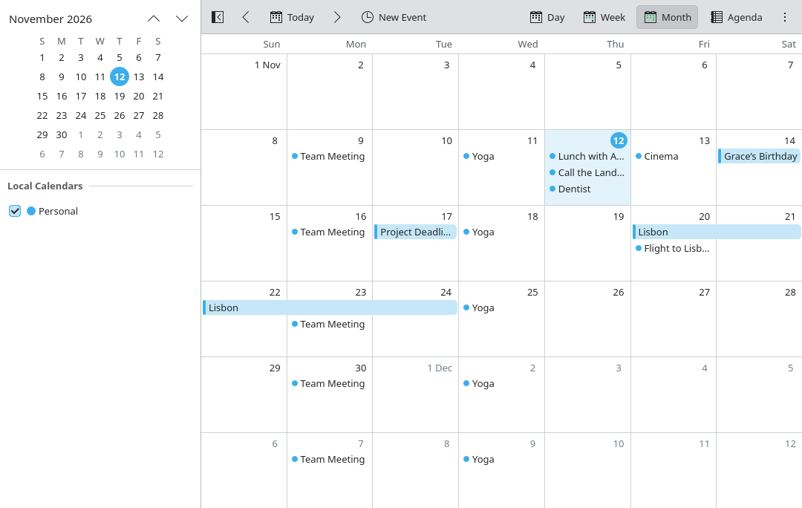

<!--
SPDX-FileCopyrightText: 2026 Kalendar contributors
SPDX-License-Identifier: CC0-1.0
-->

# Kalendar

A simple calendar for KDE Plasma that works with online accounts.



- An agenda of the next three or seven days, and week and month views.
- Google Calendar, through the Google accounts the system is signed in to, and any service that offers CalDAV: Nextcloud,
  iCloud, Fastmail, Radicale, and others.
- A calendar that is kept on this system only, so the app is usable from the first start.
- The calendars other programs keep on this system: the calendar files that Akonadi shows, such as KOrganizer's, with
  to-dos on the day they are due. Events in them can be added and changed where Akonadi lets them be.
- A lock in the sidebar on every calendar that can only be looked at.
- Events can be added, changed and deleted without a network; they are sent on at the next synchronization.
- Repeating events (every day, week, month or year); other rhythms made elsewhere are shown and kept.
- A click on an event shows it to read, with notes written as HTML shown as such; editing is one step further.
- Calendar files (`.ics`) can be imported: from the menu, by dropping them on the window, or by opening them from the
  file manager.
- Its events in KOrganizer, Merkuro and the calendar of Plasma's clock, by handing them to Akonadi from the settings.
- Settings for 12 or 24 hours, the first day of the week, and week numbers.
- Follows the system's colour scheme, fonts and locale, and reshapes itself for narrow windows and phones.

It is built with Qt Quick and Kirigami along the [Kirigami Design Guide](https://n4n0gh.github.io/Doku).

## Installing

Kalendar is distributed as a Flatpak from its own repository:

```sh
flatpak install --user https://n4n0gh.github.io/Kalendar/kalendar.flatpakref
```

or with the *Install Kalendar* link on <https://n4n0gh.github.io/Kalendar/>, which opens in Discover. Installed this
way it is kept up to date together with the other applications. How releases get there is in
[docs/releasing.md](docs/releasing.md).

A Flatpak can be built from the source tree with
`flatpak-builder --user --install --force-clean build-flatpak flatpak/io.github.n4n0gh.kalendar.yml`.

## Building

Needed: Qt 6.6 or newer, KDE Frameworks 6.8 or newer (Kirigami, KCalendarCore, KI18n, KCoreAddons, KColorScheme,
KWallet), extra-cmake-modules, and the QML modules `org.kde.kirigami` and `org.kde.coreaddons` at run time.

On openSUSE Tumbleweed:

```sh
sudo zypper install cmake ninja gcc-c++ kf6-extra-cmake-modules qt6-base-devel qt6-declarative-devel qt6-quick-devel \
    qt6-quickcontrols2-devel qt6-sql-devel qt6-sql-sqlite \
    kf6-kirigami-devel kf6-kcalendarcore-devel kf6-ki18n-devel kf6-kcoreaddons-devel kf6-kcolorscheme-devel kf6-kwallet-devel
```

```sh
cmake -B build -G Ninja
cmake --build build
build/bin/kalendar
```

## In other calendar programs, and in Plasma's clock

Kalendar can hand its events to the system: **Settings**, **Add to the System's Calendars**. The events of the
calendars that are shown in Kalendar then become one calendar of Akonadi, named *Kalendar*, which KOrganizer and Merkuro
show, and the calendar that opens from the clock in the panel too. For the clock, switch on Plasma's own plugin once:
right-click the clock, **Configure Digital Clock…**, **Calendar**, and tick **PIM Events Plugin**.

The calendar can be looked at there, not changed, and follows Kalendar by itself. Events from servers are as fresh as
Kalendar's last synchronization, so Kalendar has to run now and then. **Remove from the System's Calendars** takes it
away again.

This needs Akonadi, and its agent for calendar files, to be installed (`akonadi`, `kdepim-runtime`; for the clock,
`kdepim-addons`). Kalendar keeps the events as a calendar file in its data folder and asks Akonadi over the session bus
to show that file (`src/systemexport.*`); nothing of Akonadi is linked, and it works from the Flatpak.

Earlier versions installed a plugin of their own into Plasma's clock instead. It is gone: Kalendar removes the copy it
installed at its next start, which takes effect at the next login.

## The calendars of the system

KOrganizer, Merkuro and the calendar of Plasma's clock share their calendars through Akonadi. Kalendar shows those of
them that are calendar files, under **System Calendars** in the sidebar: KOrganizer's own calendar, and whatever a
program or the user added to the system as a calendar file. They appear by themselves wherever Akonadi runs and follow
the files as they change; a to-do that is open is shown on the day it is due.

A calendar that Akonadi lets be changed can be changed in Kalendar too: events are added, changed and deleted in it as
in any other, and KOrganizer and the others show the result a moment later. To-dos are only shown. Calendars that
Akonadi has set to read only, or whose file cannot be written, carry a lock in the sidebar, as do calendars of servers
that cannot be changed.

Kalendar asks Akonadi on the session bus which files it shows, reads those files and writes changed events into them
(`src/systemcalendars.*`, `src/core/engine.*`); nothing of Akonadi is linked, so it works from the Flatpak too, which
may read and write the home folder for this. Akonadi keeps a copy of a calendar as it was whenever another program
changes its file, in `~/.local/share/akonadi_ical_resource_<number>/`: one for every change made in Kalendar. Calendars
that Akonadi fetches from a server are not shown: add the account to Kalendar instead.

## Google accounts

Kalendar uses the Google accounts that the system is signed in to: those under **Online Accounts** in System Settings.
Signing in happens there, once for all apps; in Kalendar, **Add Account** then lists them. Kalendar never sees the
password: it asks the system for a token each time it synchronizes.

Such accounts may use Google's Calendar API but not its CalDAV, so that is what Kalendar speaks to Google
(`src/core/googleclient.*`). Events still end up as calendar files like those of any other server.

The Flatpak has no libraries for Online Accounts, so two things of the system are used directly
(`src/onlineaccounts.*`): the list of accounts in `~/.config/libaccounts-glib/accounts.db`, which is only read, and the
sign-in service (`signond`) on the session bus.

## Tests

```sh
cd build && ctest --output-on-failure
```

Two of the tests synchronize with a real CalDAV server, [Radicale](https://radicale.org), which they start themselves.
They are skipped where it is not installed. To use one from a Python environment:

```sh
python3 -m venv /tmp/radicale && /tmp/radicale/bin/pip install radicale
KALENDAR_RADICALE=/tmp/radicale/bin/python ctest --output-on-failure
```

For trying things out without touching real data, `KALENDAR_TEST_MODE=1 KALENDAR_DEMO=1 build/bin/kalendar` starts with
a few example events, keeps its data apart (in `~/.qttest`), and leaves the wallet alone.

## How it is put together

| Path | What it holds |
| --- | --- |
| `src/core/` | Storage and synchronization, without any GUI: the database, the clients for CalDAV and for Google's Calendar API, and the engine that keeps both in step and lays events out for the views. |
| `src/backend.*` | What the interface asks of the calendars; adds signing in and settings. |
| `src/onlineaccounts.*`, `src/secretstore.*` | The Google accounts of the system's Online Accounts; passwords in KWallet. |
| `src/systemcalendars.*` | Which calendar files Akonadi shows. |
| `src/systemexport.*` | Handing Kalendar's events to Akonadi as a calendar file. |
| `src/qml/` | The interface. |
| `autotests/` | Tests for the above. |

The [code documentation](docs/README.md) goes into each of these: architecture, synchronization, accounts and signing
in, the calendars of the system, the interface, and how to build, test and extend it.

## Not there yet

- Reminders, invitations and attendees, and tasks of one's own (to-dos of the system's calendars are shown).
- Akonadi's calendars that are not files: those it fetches from servers, and birthdays from the address book.
- Changing a single day of a repeating event (deleting one works, and days changed elsewhere are shown and can be edited).
- Creating, renaming and recolouring calendars; they are taken as the server has them.
- Fetching only what changed from Google: its calendars are read in full at every synchronization.
- Translations: all text is marked for translation, but none exist so far.

## Licence

GPL-3.0-or-later; see `LICENSES/`.
