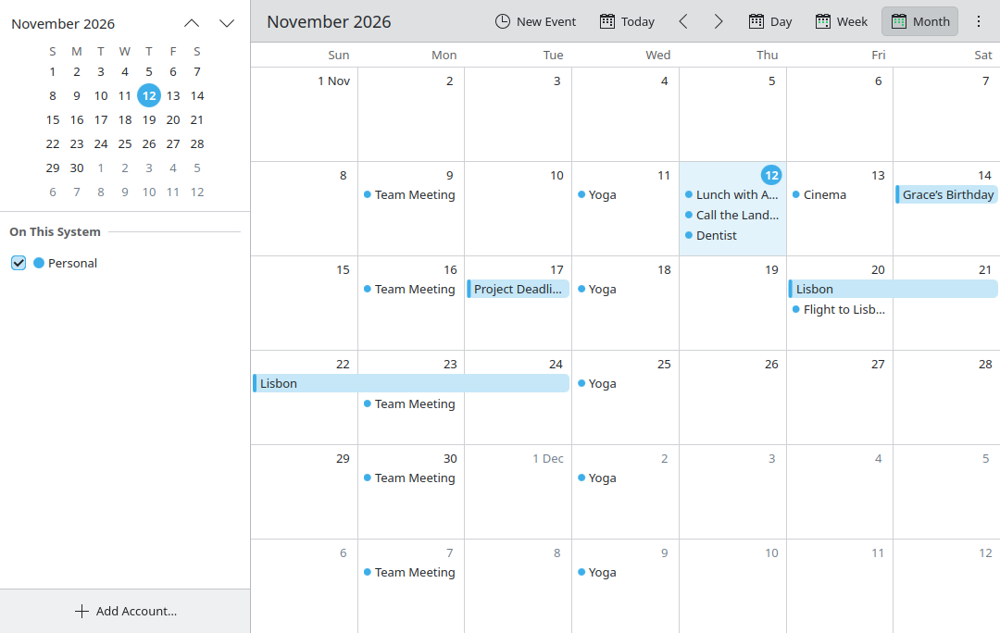

<!--
SPDX-FileCopyrightText: 2026 Kalendar contributors
SPDX-License-Identifier: CC0-1.0
-->

# Kalendar

A simple calendar for KDE Plasma that works with online accounts.



- Month, week and day views.
- Google Calendar, and any service that offers CalDAV: Nextcloud, iCloud, Fastmail, Radicale, and others.
- A calendar that is kept on this system only, so the app is usable from the first start.
- Events can be added, changed and deleted without a network; they are sent on at the next synchronization.
- Repeating events (every day, week, month or year); other rhythms made elsewhere are shown and kept.
- Follows the system's colour scheme, fonts and locale, and reshapes itself for narrow windows and phones.

It is built with Qt Quick and Kirigami along the [Kirigami Design Guide](https://n4n0gh.github.io/Doku).

## Installing

Kalendar is distributed as a Flatpak from its own repository:

```sh
flatpak install --user https://n4n0gh.github.io/Kalendar/kalendar.flatpakref
```

or with the *Install Kalendar* link on <https://n4n0gh.github.io/Kalendar/>, which opens in Discover. Installed this
way it is kept up to date together with the other applications. How releases get there is in
[docs/releasing.md](docs/releasing.md).

A Flatpak can be built from the source tree with
`flatpak-builder --user --install --force-clean build-flatpak flatpak/io.github.n4n0gh.kalendar.yml`.

## Building

Needed: Qt 6.6 or newer, KDE Frameworks 6.8 or newer (Kirigami, KCalendarCore, KI18n, KCoreAddons, KColorScheme,
KWallet), extra-cmake-modules, and the QML modules `org.kde.kirigami` and `org.kde.coreaddons` at run time.

On openSUSE Tumbleweed:

```sh
sudo zypper install cmake ninja gcc-c++ kf6-extra-cmake-modules qt6-base-devel qt6-declarative-devel qt6-quick-devel \
    qt6-quickcontrols2-devel qt6-sql-devel qt6-sql-sqlite \
    kf6-kirigami-devel kf6-kcalendarcore-devel kf6-ki18n-devel kf6-kcoreaddons-devel kf6-kcolorscheme-devel kf6-kwallet-devel kf6-kdeclarative-devel
```

```sh
cmake -B build -G Ninja
cmake --build build
build/bin/kalendar
```

## In the calendar of Plasma's clock

Kalendar comes with a plugin that shows its events in the calendar that opens from the clock in the panel. It is built
when `kf6-kdeclarative-devel` is installed. It belongs to the system's Plasma, so it does not come with the Flatpak; it
is installed from the source tree, and then also shows the events of a Kalendar that is installed as a Flatpak:

```sh
cmake -B build -G Ninja -DCMAKE_INSTALL_PREFIX=/usr
cmake --build build --target kalendarevents
sudo cmake --install build --component plasmaplugin
```

Then switch it on: right-click the clock, **Configure Digital Clock…**, **Calendar**, and tick **Kalendar**. Plasma has
to be restarted once to find a new plugin (log out and in, or `systemctl --user restart plasma-plasmashell`).

The plugin only reads. It shows the calendars that are shown in Kalendar, and follows changes made there by itself.
Events from servers are as fresh as Kalendar's last synchronization, so Kalendar has to run now and then.

## Google accounts

Google only lets registered apps sign in. Whoever distributes Kalendar registers it once:

1. In the [Google Cloud console](https://console.cloud.google.com), create a project and enable the **CalDAV API**.
2. Set up the OAuth consent screen with the scope `https://www.googleapis.com/auth/calendar`.
3. Create an OAuth client of the type **Desktop app**.
4. Build with its values:

```sh
cmake -B build -G Ninja -DKALENDAR_GOOGLE_CLIENT_ID=… -DKALENDAR_GOOGLE_CLIENT_SECRET=…
```

A build without these still offers Google, and asks for a client ID and secret when an account is added.

Signing in happens on Google's page in the web browser (OAuth 2.0 with PKCE); Kalendar never sees the password. What it
gets from Google to stay signed in, like the passwords of other accounts, is kept in KWallet.

## Tests

```sh
cd build && ctest --output-on-failure
```

Two of the tests synchronize with a real CalDAV server, [Radicale](https://radicale.org), which they start themselves.
They are skipped where it is not installed. To use one from a Python environment:

```sh
python3 -m venv /tmp/radicale && /tmp/radicale/bin/pip install radicale
KALENDAR_RADICALE=/tmp/radicale/bin/python ctest --output-on-failure
```

For trying things out without touching real data, `KALENDAR_TEST_MODE=1 KALENDAR_DEMO=1 build/bin/kalendar` starts with
a few example events, keeps its data apart (in `~/.qttest`), and leaves the wallet alone.

## How it is put together

| Path | What it holds |
| --- | --- |
| `src/core/` | Storage and synchronization, without any GUI: the database, the CalDAV client, and the engine that keeps both in step and lays events out for the views. |
| `src/backend.*` | What the interface asks of the calendars; adds the wallet and signing in. |
| `src/googleauth.*`, `src/secretstore.*` | Signing in to Google; passwords in KWallet. |
| `src/qml/` | The interface. |
| `src/plasma/` | The plugin for the calendar of Plasma's clock. |
| `autotests/` | Tests for the above. |

## Not there yet

- Reminders, invitations and attendees, and tasks.
- Changing a single day of a repeating event (deleting one works).
- Creating, renaming and recolouring calendars; they are taken as the server has them.
- Translations: all text is marked for translation, but none exist so far.

## Licence

GPL-3.0-or-later; see `LICENSES/`.
